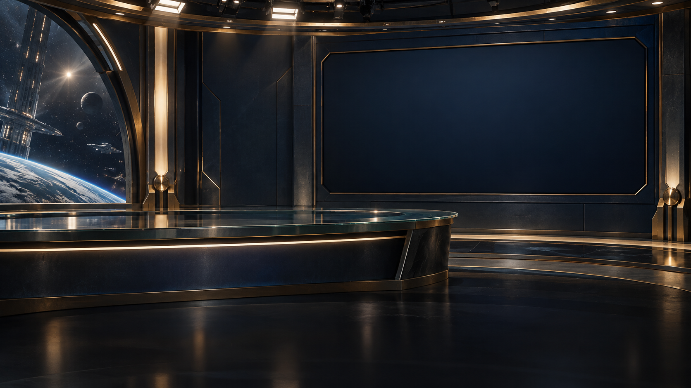

# GNN broadcast studio

An original race-neutral backdrop for the game's Galactic News Network screen, generated with built-in ImageGen. Native size: **1672 × 941**; requested size: 1920 × 1080. No upscaling was applied.

The studio includes an opaque desk and blank video wall. The game should supply the anchor, GNN branding, story imagery, headlines, and ticker separately. This is an uploaded art asset, not a renderer integration.

Read [asset-manifest.json](asset-manifest.json) for AI placement guidance, or the same-name JSON sidecar. Identical metadata is embedded in the PNG under the case-sensitive iTXt key `MOOgenesis.asset`. The record includes race scope, purpose, estimated composition regions, source modules, and the generation prompt. The prompt is also available in [generation-prompt.txt](generation-prompt.txt).

The generated desk sits higher than the current procedural desk. Integration requires adjusted anchor framing and foreground occlusion, plus mapping story graphics to the visible video wall. Retain procedural fallback and check responsive cropping. The validation report verifies PNG checksums, matching metadata, and unchanged generated pixel data.
